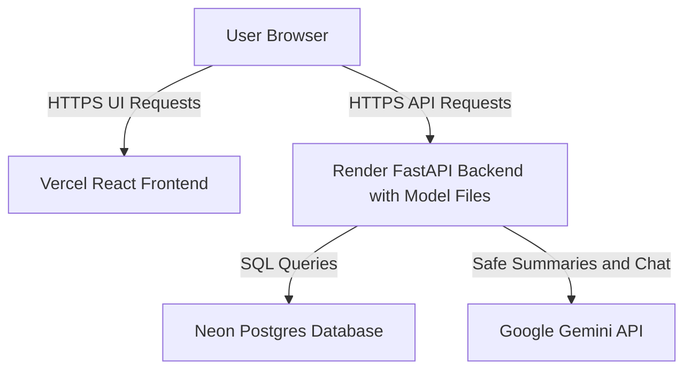
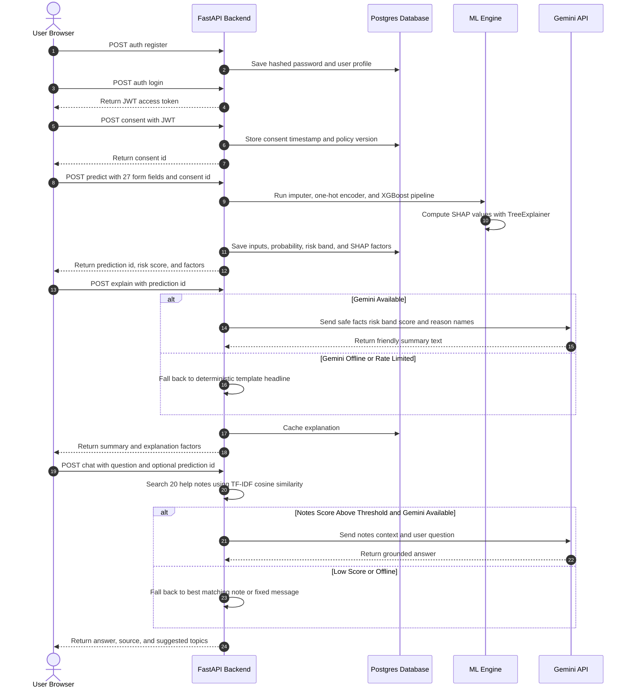
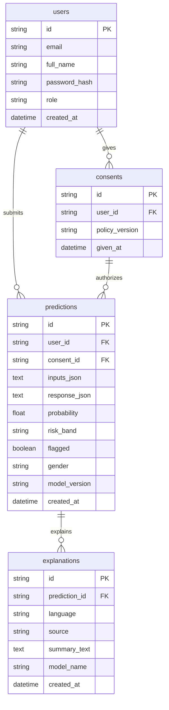

# System Architecture

Data Dynamo is a full-stack, machine-learning-powered credit risk assessment application. This document outlines the overall system architecture, runtime request workflows, and database entity relationships.

---

## 1. System Topology

The production architecture separates the frontend single-page application, containerized backend API, managed serverless database, and external LLM services.

### Architecture Notes
- **Frontend (Vercel)**: React single-page application built with Vite, Tailwind CSS, and Recharts. Served via global edge CDN.
- **Backend (Render)**: FastAPI web application running in a Docker container with local ML model artifacts loaded into memory during startup.
- **Database (Neon Postgres)**: Managed serverless PostgreSQL connected over TLS using SQLAlchemy 2 and the `psycopg` (v3) driver.
- **External AI (Google Gemini API)**: Generates natural language summaries and powers the contextual help assistant.

### Local Docker Compose Environment
For local development, the system is orchestrated via `docker-compose.yml` with three local containers:
- **`datadynamo-db`**: PostgreSQL 16 container exposed on port 5432 with health check monitoring.
- **`datadynamo-backend`**: FastAPI application container running via Uvicorn on port 8000.
- **`datadynamo-frontend`**: NGINX Alpine container serving the production React build on port 3000 with client-side SPA routing.

---

## 2. Request Flow & Execution Lifecycle

The sequence diagram below illustrates the complete lifecycle from initial registration to scoring, explainability, and help chat.

### Execution Details
1. **Authentication**: Credentials are authenticated with bcrypt password verification; authenticated sessions use signed HS256 JWT tokens with a 1-hour expiration.
2. **Consent**: The user must explicitly accept data processing policies prior to submitting an evaluation. The generated `consent_id` is required by the prediction endpoint.
3. **Scoring Pipeline**: The API transforms 27 application fields through direct mapping, feature computation (age, employment, financial ratios), categorical one-hot encoding, and median imputation, before feeding the 226-feature vector to XGBoost.
4. **SHAP Attribution**: Local TreeExplainer attribution calculates the exact log-odds contribution of each feature to identify the top factors moving the risk score.
5. **AI Summarization & Fallback**: `/explain` sends only high-level risk band, rounded score percentage, and plain reason names to Gemini. When the LLM is unreachable or rate limited, a deterministic rule-based template summary is served immediately.
6. **RAG Help Assistant**: `/chat` searches 20 offline markdown knowledge notes via TF-IDF cosine similarity. If the similarity score exceeds the threshold, Gemini synthesizes a grounded response; otherwise, a safe standard answer is returned.

---

## 3. Database Schema

The database consists of four tables implemented in SQLAlchemy 2 using string-based UUID primary keys.

### Table Specifications
- **`users`**: Manages applicant and administrator credentials, full names, roles (`user` or `admin`), and account creation timestamps.
- **`consents`**: Retains user agreements to specific policy versions prior to evaluation execution.
- **`predictions`**: Stores raw input parameters, full model responses, risk score, risk band (`LOW`, `MEDIUM`, `HIGH`, `VERY_HIGH`), demographic markers for fairness tracking, and model version identifiers.
- **`explanations`**: Caches generated multi-language summaries keyed by unique `(prediction_id, language)` constraints to prevent duplicate external LLM invocations.

